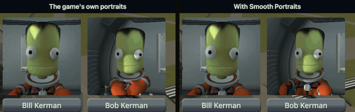

# Smooth Portraits

The crew's portraits at the bottom right of the flight screen, drawn as often as the game itself. The game redraws
them only seven to ten times a second, which is why the faces jerk. Nothing else about the picture is changed.

For Kerbal Space Program 1.12.x. **Needs [Keystone](https://github.com/IshiakiZ/ksp-keystone)**, a separate download
([on SpaceDock](https://spacedock.info/mod/4665/Keystone)): this mod does not load without it.

## Install

Copy the `SmoothPortraits` folder from the download into your KSP's `GameData`, beside `Keystone`. It is on as
installed.

## Settings

In the Keystone window (the keystone button on the game's toolbar, or Alt-K; Option-K on a Mac): the most pictures a
second (60 as installed), the most of each frame's time the portraits may take (3 %), and whether kerbals outside
the ship are included.

## Good to know

* It costs about 0.2 ms a frame for one portrait at 60 pictures a second, and never more than the share you set:
  where that does not pay for every portrait in every frame, the portraits take turns.

## Works on

Windows 11 and Mac: tried. Linux: never run (it is plain C#, with nothing of one system's in it).

**More:** [the long description](https://github.com/IshiakiZ/ksp-smooth-portraits/wiki/The-long-description) (everything in full, and
what was tried on each system) and the rest of the [wiki](https://github.com/IshiakiZ/ksp-smooth-portraits/wiki).

## Licence

[CC BY 4.0](LICENSE): use it, change it and pass it on as you like, as long as you credit Ishiaki and link back here.
